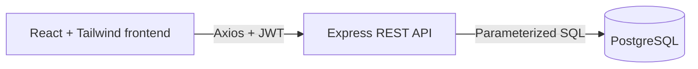

# ClinicFlow application architecture

ClinicFlow is a modular PERN application for managing clinic users, patients,
appointments, and dashboard statistics. The frontend and backend communicate
through a JSON REST API, while PostgreSQL provides persistent storage and a
final layer of data-integrity protection.

## System overview



The frontend never connects directly to PostgreSQL. It sends HTTP requests to
the Express API, which validates access and input before executing SQL.

## Backend layering

```text
Routes → Middleware → Controllers → Services → PostgreSQL
```

- **Routes** define endpoint paths and attach authentication, role checks, and
  request validation.
- **Middleware** verifies JWTs, enforces admin/staff permissions, validates
  request bodies, parameters, and queries with Zod, and centralizes errors.
- **Controllers** translate HTTP requests into service calls and return the
  documented HTTP status and JSON response.
- **Services** contain business rules, transactions, and parameterized SQL.
- **PostgreSQL** enforces primary keys, foreign keys, unique values, checks,
  enums, and the confirmed-appointment constraint as a final safety layer.

This separation keeps HTTP concerns out of business logic and keeps database
queries out of routes and controllers.

## Frontend architecture

- React Router defines public, protected, and admin-only pages.
- Feature-specific Axios modules handle authentication, patients,
  appointments, dashboard statistics, and users.
- `AuthContext` owns the current session and restores it after a page refresh.
- Page and form state stays local to React components; Redux is unnecessary for
  the current application size.
- Shared forms, pagination, status badges, statistic cards, layout, and route
  guards reduce repeated UI logic.
- Tailwind CSS, integrated through the official Vite plugin, provides the
  responsive visual system and accessible focus states.

## Authentication flow

```text
Login → bcrypt verification → JWT returned → localStorage
      → Axios Bearer header → backend auth middleware
```

The backend compares the submitted password with the stored bcrypt hash. After
a successful login, it signs a JWT containing the user ID and role. The
frontend stores that token and the Axios request interceptor sends it as
`Authorization: Bearer <token>`. Protected backend routes verify the token and
apply role-based authorization where required. Password hashes are never
returned by the API.

## Important technical decisions

- **Raw `pg` instead of an ORM:** the small schema remains explicit, and every
  dynamic value is passed through a parameterized query.
- **Zod validation:** request bodies, route parameters, and query parameters are
  validated before reaching service logic.
- **Central error handling:** expected application and PostgreSQL errors use one
  consistent JSON shape; unexpected details remain server-side.
- **Patient-specific scheduling rule:** confirmed appointments for the same
  patient must be at least 30 minutes apart. A service transaction and advisory
  lock handle concurrent requests, while PostgreSQL provides a constraint-level
  safety net.
- **Separate integration-test database:** Jest and Supertest reset only a
  database whose name ends with `_test`, protecting development data.
- **Containerized environment:** Docker Compose provides reproducible database,
  backend, and frontend services with health checks and persistent PostgreSQL
  storage.

## Deployment structure

Docker Compose runs three services:

1. **PostgreSQL** uses a health check and a named volume so application data
   survives container restarts.
2. **Backend** waits for PostgreSQL to become healthy, applies migrations,
   seeds only an empty database, and then starts the Express API.
3. **Frontend** is built with Vite and served by Nginx. It starts after the
   backend health check succeeds and connects to the configured API URL.

For local Docker development, the frontend is exposed on port `5174`, the API
on port `4001`, and PostgreSQL on port `5433`. These mappings avoid conflicts
with the normal non-containerized development ports.
