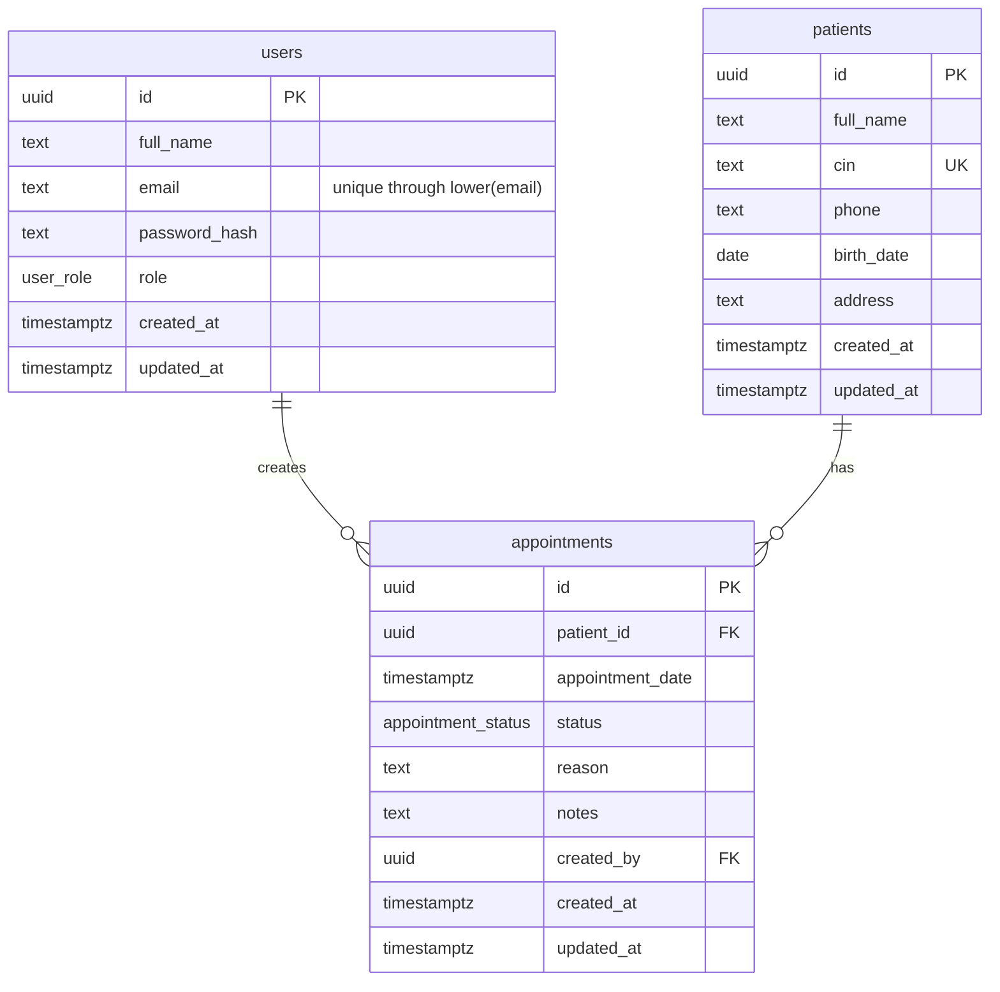

# ClinicFlow database design

ClinicFlow uses PostgreSQL to store application users, patient records, and
appointments. `backend/db/migrations/001_init.sql` is the source of truth for
the schema. The design keeps the relationships small and explicit for a junior
PERN technical test while preserving data integrity at the database level.

## Entity relationship diagram

## Relationships

| Relationship | Type | Reason |
| --- | --- | --- |
| `patients` → `appointments` | 1-N | One patient can have many appointments, and every appointment belongs to one patient through `patient_id`. |
| `users` → `appointments` | 1-N | One staff member can create many appointments. `created_by` records the responsible application user. |
| `users` and `patients` | None | Patients are clinic records, not application accounts, so no direct relationship is required. |
| 1-1 relationships | Not required | The current domain has no entity that belongs exclusively to exactly one record in another table. |
| N-N relationships | Not required | Each appointment currently belongs to one patient and has one creator. |
| Possible doctors extension | 1-N | If doctors were added later, `appointments.doctor_id` would normally create another 1-N relationship. |

## Keys, constraints, and data types

- Every table uses a UUID primary key generated with `gen_random_uuid()`.
- User roles use the `user_role` enum: `admin` or `staff`.
- Appointment statuses use the `appointment_status` enum: `pending`,
  `confirmed`, or `cancelled`.
- `patients.cin` is unique. `users.email` is case-insensitively unique through
  the `users_email_lower_key` index on `lower(email)`.
- Names, patient phone numbers, CIN values, and appointment reasons have
  non-empty checks. A patient's `birth_date` cannot be later than the current
  date.

## Foreign-key deletion rules

- `appointments.patient_id` references `patients.id` with `ON DELETE CASCADE`.
  Deleting a patient also removes appointments that cannot exist without that
  patient.
- `appointments.created_by` references `users.id` with `ON DELETE RESTRICT`.
  A user who created appointments cannot be deleted while those traceability
  records still reference that user.

## Indexes

| Index | Purpose |
| --- | --- |
| `users_email_lower_key` | Case-insensitive email uniqueness and lookup. |
| `patients_cin_key` | CIN uniqueness and lookup. |
| `idx_patients_full_name_trgm` | Fast partial, case-insensitive patient-name searches. |
| `idx_patients_created_at` | Supports the default patient ordering and pagination. |
| `idx_appointments_patient_date` | Supports patient appointment history ordered or filtered by date. |
| `idx_appointments_date` | Supports calendar and date filtering. |
| `idx_appointments_status` | Supports status filters and dashboard counts. |
| `idx_appointments_created_by` | Supports creator foreign-key lookups. |

## Confirmed-appointment protection

One patient cannot have two confirmed appointments whose start times are less
than 30 minutes apart. For the same patient, **10:00 and 10:20 conflict**, while
**10:00 and 10:30 are allowed**. A different patient may have a confirmed
appointment at 10:20. Pending and cancelled appointments do not reserve a time.

The application service checks this rule inside a database transaction and
acquires a PostgreSQL advisory lock before checking the patient ID and time
window. This serializes competing confirmation requests. The patient-scoped
exclusion constraint in `001_init.sql` is the database-level safety net for
inserts or updates that reach PostgreSQL outside the normal service path.
